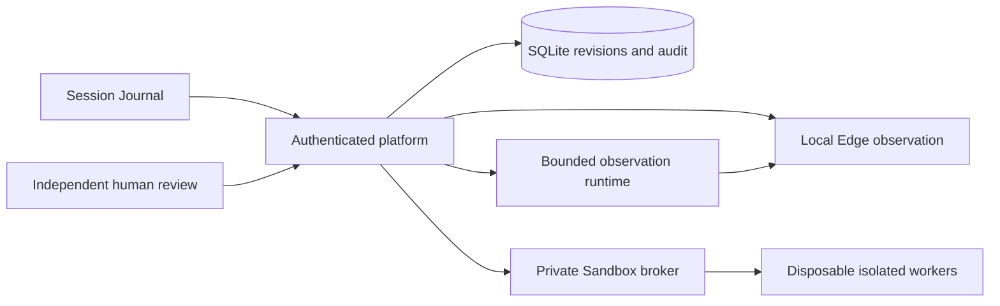

# CertaRig Session Journal

The product entry `/` now opens the selected Session Journal A. `/classic` retains the original product shell; legacy Edge Studio is unchanged. This is a local observation release candidate, not a public service or physical qualification.

## Product routes

| Destination | Preserved workflow |
|---|---|
| Sessions | Project/bench context, saved conversations, resumable drafts, readable definition differences, background evaluation and context inspector |
| Agents and teams | Guided or advanced immutable versions, fixed output contract, model/tool permissions, bounded limits, evaluated exact member selection |
| Benches | Enrollment, explicit grants, source observations, profile review, guided/advanced bench descriptions and support reports |
| Sandbox | Python/SPICE definitions, source and contracts, tests/review, parameters, recording selection, progress/cancel and safe artifact inspection |
| Evidence | Filters, readable findings, raw observations and tool traces, downloads and offline integrity verification |
| Deployments | Independent reviewed observation, separate start, runtime health, lease, activity and revoke |
| Connectors | Public MQTT/serial/Modbus mapping proposals and independent review; operator installation remains separate |
| Settings | Application identity, role, sign-out, managed model sign-in/status/disconnect and deployment consent |

The active-access revoke strip follows navigation and includes permitted active deployments across benches. Project membership never grants equipment access. A successful analysis does not issue qualification. API requests keep server-derived identities, current asset grants and CSRF checks.

Saved `#/sessions/{draft-or-version-id}` links restore recorded provenance. Standalone versions show that no originating conversation was recorded. Advanced authoring can save a resumable draft against an owned individual version, preserving its lineage and base-definition difference. Draft conflicts retain local changes and offer server comparison, reload or a separate inert draft. Saving is serialized so immediate commit cannot race an earlier autosave. Context changes and revoked access discard late presentation results. Analysis parameters, replay choice and caret are retained when task polls update.

## Bench Specification version 1

`/v1/bench-specs` creates/lists descriptions; `/{id}` reads; POST `/{id}/revise`, `/assess`, `/propose` and `/review` operate on exact records. Schema: `certarig/schemas/bench-spec-facts.json`. Revision and review history are retained. Unlinked records are owner-private; linked records check the asset grant on each access. Independent description review is bound to revision and content hash and grants no execution authority.

Facts accept bounded operator descriptions, equipment identities, channel quantities/units, scaling, calibration and source references, limits, freshness, unresolved questions and an optional imported recording. Facts remain operator-declared. A recording reference retains its unverified-origin label; no uploaded/manual instructions are executed. Automatic PDF/OCR interpretation and live-language extraction are not claimed.

Support status is one of `mapping_evidence_missing`, `analysis_only`, `procedure_qualification_required` or `unsupported_transport`. The report separately states whether the transport and procedure template are recognized, lists blockers and conversion metadata, and always returns `qualified: false` and `authority: none`. A complete familiar description still needs the exact profile/procedure evaluation. Unknown electrical experiments remain analysis-only.

Unit handling preserves quantity context: absolute temperature versus difference, pressure gauge/absolute/differential reference, original units and tested gain/offset. Supported electrical descriptions use V, A, mA or digital state. Missing facts remain missing; zero is valid. No general confidence score or universal bench-recognition claim is provided.

Reviewer-only `/v1/connectors/registered` returns public registration metadata, never endpoints, device paths or credentials. Agent tools may draft/read/assess descriptions; they cannot review, install or apply configuration. Updated OpenAPI, PlatformClient and workbench manifest describe these additions.

## Local demonstration and checks

Use the setup in [AGENT_LIFECYCLE.md](AGENT_LIFECYCLE.md) and [INNOVATOR_WORKBENCH.md](INNOVATOR_WORKBENCH.md) for the actual local platform. The source checkout is required for Studio assets; wheel resource/import checks do not establish a standalone wheel-hosted UI installation.

To inspect the isolated design prototype, serve only Studio on loopback:

```sh
.venv/bin/python -m http.server 18121 --bind 127.0.0.1 --directory studio
```

Open http://127.0.0.1:18121/prototype.html. Its clearly labelled fixture controller makes no platform/model/equipment requests and cannot grant real authority. Run `node studio/check-prototype.mjs` against that server. `CERTARIG_PROTOTYPE_URL` can select another local prototype URL. Tests write only the documented validation directory.

Run `make lint typecheck coverage`, `make soak`, the platform Playwright configuration and the legacy Edge browser configuration. See [validation/session-journal/README.md](validation/session-journal/README.md) for actual results and open gates. Genuine Dex/Codex qualification, the pinned image/seven real-container cases, external equipment and native mobile keyboard behavior remain distinct from fixtures.

## Architecture



The arrows show software data/workflow relationships, not permission for a model to grant authority. Edge acquisition remains independent of agent inference and Sandbox jobs.
