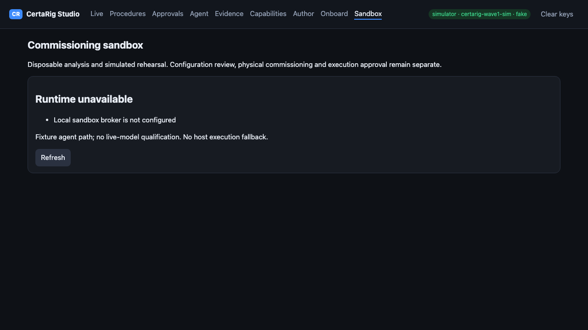

# CertaRig Sandbox implementation checkpoint — 11 November 2026

**Publication update — 13 November:** A fresh local `make check` now passes with 90.33% coverage. The soak check and all ten Studio browser tests also pass. See the [dated validation record](validation-2026-11-13/summary.json) and its hashed logs. Real-container qualification and a Codex Cloud run remain outstanding. The checkpoint account below preserves the historical 11 November results and storage failure.

**Software implemented; runtime release blocked and unqualified.** No disposable worker has run in the dedicated VM during this implementation session. The frozen Phase 3 installation and physical hardware were not changed.

## Reviewable delivery

| Increment | Implementation | Verification boundary |
| --- | --- | --- |
| Workspace and broker contracts | Immutable revision snapshots, ownership, atomic audit history, private Unix RPC, preflight and fixed quotas | Software and mocked engine tests; real runtime pending |
| Python and SPICE execution | Fixed Docker policy, separate Colima profile preparation, pinned image ID, deadline/cancellation, safe artifact collection | Launch protocol tested with mocks; image build and containment tests not run |
| Trusted rehearsal and proposals | Separate fixed harness, mandatory fault scenarios, HMAC receipts bound to exact inputs, operator review and offline replay | Both simulator profiles exercised by trusted host-side unit tests; container qualification pending |
| Studio and agent workflow | Sandbox view, safe previews, structured agent tools, SDK/OpenAPI additions, human review and export, deterministic demo driver | Browser checks pass; full real-container success/refusal demo pending |

The prepared demo includes a deliberately incompatible thermal mapping, correction, model analysis with a plot, an inductive flyback SPICE experiment, trusted rehearsal, an inert human-review proposal and bundle verification. Preparing this driver is not evidence that its real-container run succeeded.

## Validation

Results and the resource probe are recorded in [validation.json](validation.json). A complete `make check` passed with 343 tests passing, 8 skipped and 90.26% coverage before the last storage-quota collection check was added. That final fix passed its targeted test; lint, typing and the Sandbox cases passed in the subsequent full repeat. However, that repeat encountered `OSError: [Errno 28] No space left on device` in a simulator recording flush, stopped progressing and was interrupted. **A clean complete regression at the final implementation commit remains outstanding.** Hardware and live-provider tests are excluded by the existing markers; the 90% threshold was preserved.

The separate slow scenario/soak check and all ten Studio browser tests passed. The two Sandbox browser checks were also repeated successfully after the final UI change. Browser tests use an explicitly fake provider; their fixtures do not qualify a live model or container isolation.

Seven sandbox runtime cases remain unrun: host/network isolation, deadline, memory, process count, excessive output, ngspice execution, and trusted container rehearsal/repeatability. Normal CI skips these tests; a skip cannot release the runtime. The unrelated opt-in MQTT integration test also skips when no local broker port is configured.

This screen was captured from the real Studio route with no sandbox broker configured, not from a successful worker run.

## Resource blocker and unchanged workloads

The required baseline is at least 8 GiB free disk and normal macOS memory pressure (level 1). The machine remained below that threshold with elevated pressure (level 2), including transient complete exhaustion; see the timestamped final probe in the JSON record. Only about 7 MiB of disposable temporary artifacts from this task's completed pytest runs were removed so Git could save the work. No pre-existing data was deleted, unrelated workloads stopped or isolation requirements weakened. Read-only inspection showed only the existing Colima `default` profile and the original `colima` Docker context; the sandbox profile/image was not created.

## Exact continuation steps

1. Make at least 8 GiB free on the Mac's data volume. Close memory-heavy workloads manually until memory pressure is normal. No extra hardware or paid service is needed for this software increment.
2. In this checkout, run `.venv/bin/python -m certarig sandbox preflight` and resolve every reported blocker. A missing image is expected before preparation.
3. Re-run `make check` and `make soak` on the final commit with adequate storage, then run `.venv/bin/python -m certarig sandbox prepare` and `.venv/bin/python -m certarig sandbox qualify`. Preparation creates only the dedicated profile; qualification must pass all seven real-container tests without skips. Fix any failure before serving jobs.
4. Run `.venv/bin/python -m certarig sandbox serve`, then launch local Edge/Studio using the separate evidence directory and instructions in [README.md](README.md). Use a development copy of the rig configuration when applying proposals.
5. Run the deterministic demo driver with a fresh local agent key and inspect the proposal in Studio. Applying a configuration is a separate human action. Re-run active-rig commissioning and obtain fresh execution approval where required.

## Evidence and claim limits

Trusted receipts cannot be created by generated analysis reports, successful process exit or agent explanations. The verifier recomputes sample summaries, safety invariants and supported checks from raw recordings/events; changing a revision, model, procedure, image or binding prevents reuse. Interview-origin promotion rechecks the validated interview revision and binds its calibration/source evidence through the existing apply flow.

The SPICE example is a behavioral 12 V inductive-load/diode model. It is not a physical component approval, valve release-time measurement or pressure-system qualification. Hard termination may prevent final trace flushing; termination metadata records incomplete artifacts and no rehearsal pass is granted. Offline checks establish evidence consistency and replay; HMAC authenticity requires the original trusted broker. This is a local single-user boundary, not public multi-tenant security certification.

## Project continuity

No paid model calls, hardware writes, Pi installation changes, public deployment or purchases were made. Physical procurement/commissioning and live-provider qualification remain separate milestones. GBrain tools are unavailable in this session; restarting Codex may load the registered server. No memory files were updated. Skill-capture review defers a new sandbox workflow skill until real-runtime qualification is verified.
